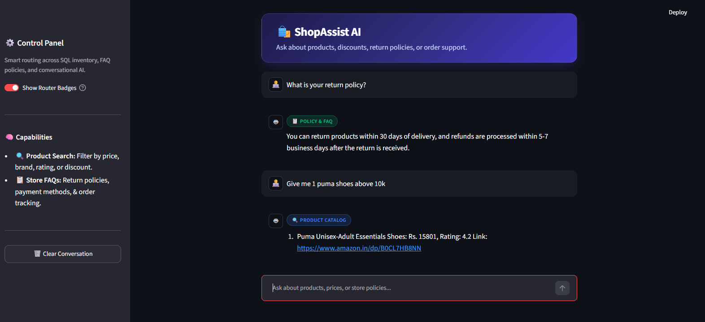
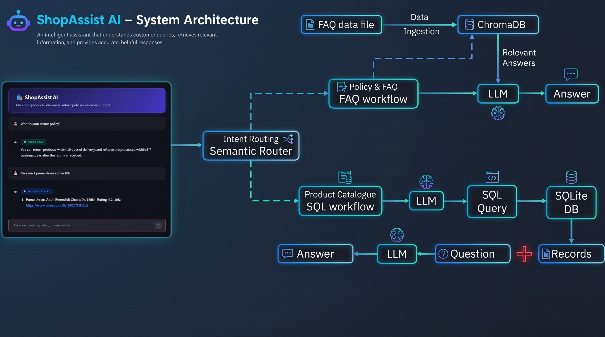
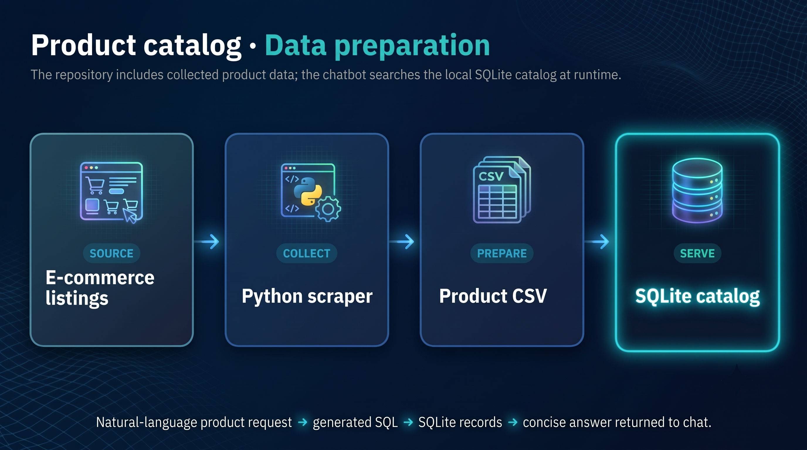

# ShopAssist AI — E-Commerce Chatbot

ShopAssist AI is a Streamlit chatbot that answers product questions and store support questions. A semantic router selects between two workflows: product catalog search and policy or FAQ retrieval.

Live Link --> https://shopassist-ai.streamlit.app/



## Features

- Search products using criteria such as brand, price, rating, and discount.
- Answer policy questions about returns, refunds, payment methods, and order tracking.
- Display an optional badge showing which workflow answered.

## Architecture



The semantic router uses `sentence-transformers/all-MiniLM-L12-v2`.

- **FAQ:** Retrieves relevant question and answer entries from ChromaDB, then asks Groq to formulate a response from that context. Source entries are in `resources/faq_data.csv`.
- **Product search:** Asks Groq to generate SQL, runs it against `resources/db_amazon.sqlite`, then asks Groq to summarize the records.

Both workflows return their answer to the Streamlit chat interface. Questions that do not match either route receive a prompt to rephrase. Chat history is kept in Streamlit session state.

### Product catalog data flow



The chatbot uses the SQLite catalog included in `resources/db_amazon.sqlite` at runtime. Product listings are not scraped during a chat session.

## Requirements

- Python 3.12 or newer (`.python-version` currently selects Python 3.13.5)
- [uv](https://docs.astral.sh/uv/)
- A Groq API key and a model name available to your account

## Setup

Run these commands from the root directory:

```bash
uv sync
```

Create a `.env` file in the root directory with:

```dotenv
GROQ_API_KEY=your_groq_api_key
GROQ_MODEL=your_groq_model_name
```

Keep the key private; do not commit `.env`.

The first run may download the sentence-transformer model. `router.py` currently sets the encoder device to `cpu`.

## Run the app

From the root directory:

```bash
uv run streamlit run main.py
```

Example questions:

- `Show Nike shoes under ₹3000`
- `What is your return policy?`
- `How can I track my order?`

## Run tests

From the root directory:

```bash
uv run pytest
```

The dispatch tests replace the router and model-backed chains with stubs, so they do not need Groq credentials or model downloads.

## App files

```text
.
├── README.md                  Project documentation
├── pyproject.toml             Project metadata and dependencies
├── uv.lock                    Locked dependency versions
├── .python-version            Python version selected by uv
├── .gitignore                 Files excluded from version control
├── __init__.py                Project package marker
├── main.py                    Streamlit chat interface
├── chat.py                    Router-to-chain dispatch
├── router.py                  Semantic route definitions and encoder setup
├── faq.py                     FAQ retrieval and response generation
├── sql.py                     Product SQL generation, execution, and response generation
├── resources/
│   ├── db_amazon.sqlite       Product catalog database
│   ├── faq_data.csv           FAQ source questions and answers
├── docs/
│   └── images/
│       ├── data_ingestion.png Product catalog data flow diagram
│       └── sys_arch.png       Chatbot system architecture diagram
└── tests/
    ├── __init__.py
    ├── conftest.py            Pytest path configuration
    └── test_chat.py           Chat dispatch tests
```


## Notes

- FAQ records are ingested into ChromaDB when the Streamlit app starts. The app does not scrape or refresh product listings while answering questions.
- Product search expects the `amazon_product_data` table in the included SQLite database.
- The SQL workflow expects generated statements inside `<SQL>...</SQL>` tags.


## License

This project is open-source and available under the [MIT License](LICENSE).